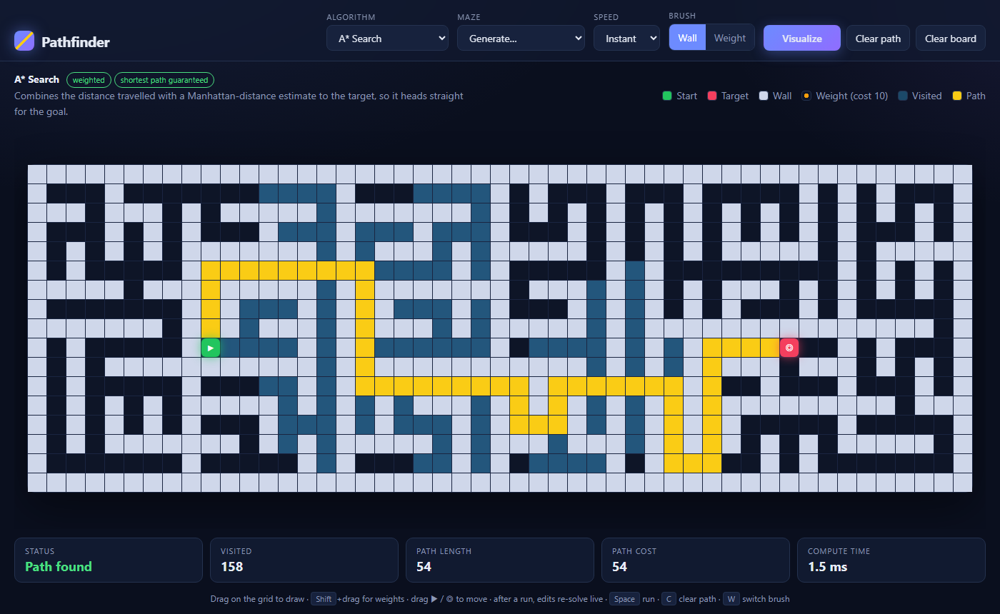

# Pathfinder: Algorithm Visualizer

[](https://github.com/mallicee/pathfinder/actions/workflows/tests.yml)
[](LICENSE)

**[▶ Live demo](https://mallicee.github.io/pathfinder/)**

An interactive, dependency-free visualizer for pathfinding and maze-generation algorithms.
Draw walls and weighted cells, generate a maze, and watch A*, Dijkstra, BFS and others search the grid in real time.



**Compare all** runs every algorithm on the same board. Here A* finds the same optimal path as Dijkstra while exploring a third of the cells:


## Features

- **6 search algorithms**: A*, Dijkstra, Greedy Best-First, BFS, Bidirectional BFS, DFS
- **4 generators**: recursive division, recursive backtracker (with loops), random walls, random weights
- **Weighted cells**: a weight costs 10 to enter, so the difference between weighted and unweighted algorithms is visible
- **Live re-solve**: after a run, dragging start/target, drawing walls or switching the algorithm recomputes the result instantly, which makes comparing algorithms on the same board easy
- **Compare all**: a side-by-side table of visited cells, steps, cost and time for every algorithm; click a row to show it on the grid
- **Stats**: visited cells, path length, path cost, compute time
- **Mouse, pen and touch** input via Pointer Events, plus line interpolation for fast strokes
- **Shareable setups** through URL parameters
- **Keyboard shortcuts**: `Space` run / stop · `C` clear path · `W` switch brush · `K` compare · `Shift`+drag draws weights
- Responsive layout, `prefers-reduced-motion` support

## Run it

No build step and no dependencies. Open `index.html` in a browser.

To host it, push the folder to GitHub and enable **Settings → Pages → Deploy from branch**.

### URL parameters

| Param   | Values                                                        |
|---------|---------------------------------------------------------------|
| `algo`  | `astar`, `dijkstra`, `greedy`, `bfs`, `bidirectional`, `dfs`   |
| `maze`  | `division`, `backtracker`, `random`, `weights`                 |
| `speed` | `0.5`, `2`, `6`, `0` (instant)                                 |
| `run`     | present = run immediately                                    |
| `compare` | present = open the comparison table                          |

Example: [`?algo=astar&maze=division&speed=0&run`](https://mallicee.github.io/pathfinder/?algo=astar&maze=division&speed=0&run)

## Tests

Open `tests/index.html` in a browser. On every push, GitHub Actions also runs the suite in headless Chrome. It checks that:

- every algorithm returns a valid, wall-free, connected path or correctly reports that none exists;
- Dijkstra and A* match a brute-force reference solver's **optimal cost** on 200 random weighted boards;
- BFS and Bidirectional BFS match the reference's **minimum step count**;
- generated mazes keep every room reachable.

## How it works

```
js/algorithms.js   pure algorithms: grid in, { visited, path, found, cost } out
js/mazes.js        generators: return an ordered list of cell operations
js/app.js          UI: rendering, input, animation, stats
```

Algorithms are pure functions that return the **exploration order** rather than drawing anything themselves.
The UI replays that order frame by frame, so the same code serves animated, instant and live re-solve modes, and it can be unit-tested without a DOM.

- Dijkstra, A* and Greedy share one best-first core built on a binary heap with lazy deletion. Only the priority function differs: `g`, `g + h` or `h`.
- A* uses the Manhattan distance, which is admissible because the cheapest step costs 1, so A* stays optimal.
- Ties in the heap are broken by `h`, which keeps A* exploration tight and directed.
- Mazes use odd/even cell parity: rooms sit on odd coordinates, walls on even ones. That guarantees connectivity, and start/target placed on odd cells are always reachable.

| Algorithm         | Weighted | Shortest path |
|-------------------|:--------:|:-------------:|
| A*                | ✓        | ✓             |
| Dijkstra          | ✓        | ✓             |
| Greedy Best-First | ✓        | ✗             |
| BFS               | ✗        | ✓ (in steps)  |
| Bidirectional BFS | ✗        | ✓ (in steps)  |
| DFS               | ✗        | ✗             |

## Tech

Vanilla JavaScript (ES2020), CSS Grid and animations, Pointer Events, ResizeObserver, `<dialog>`. No frameworks or build tools.

## License

[MIT](LICENSE)
